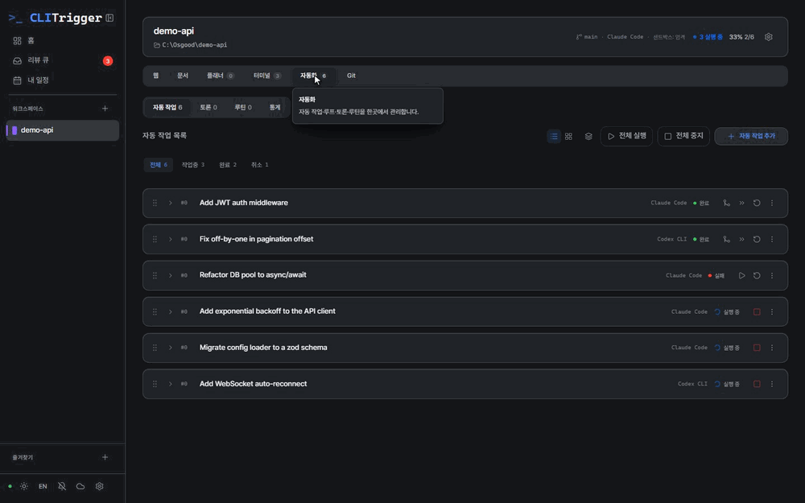
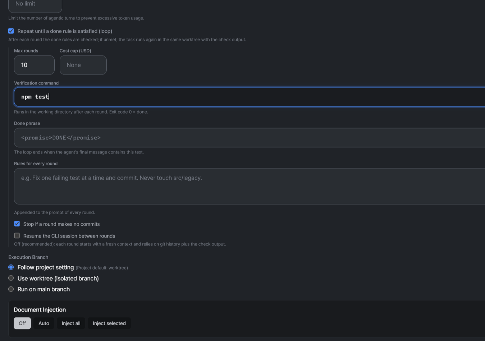
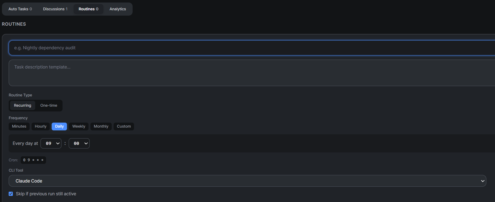
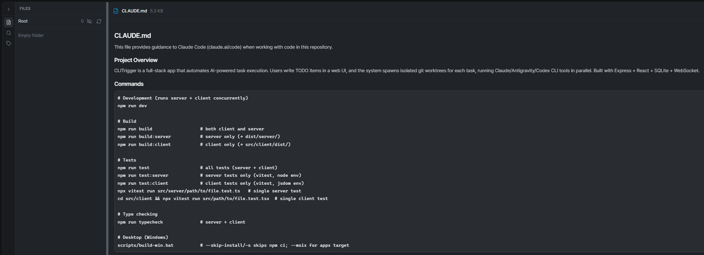
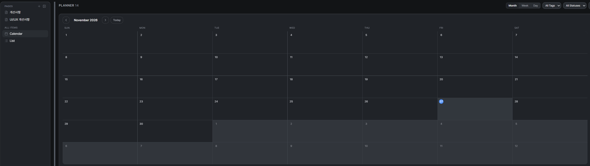
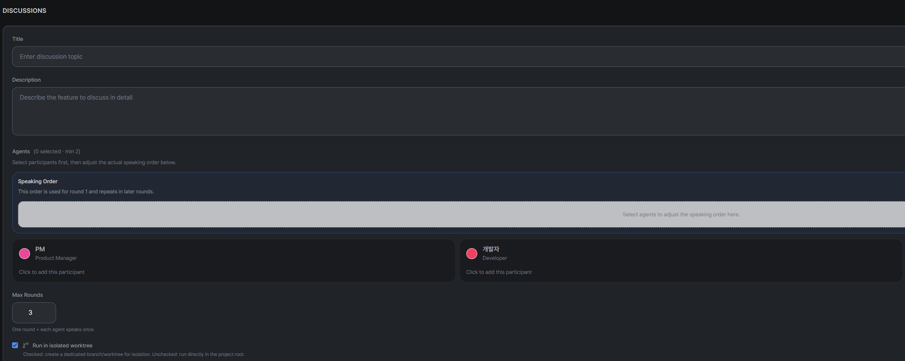
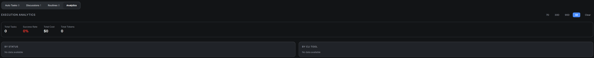
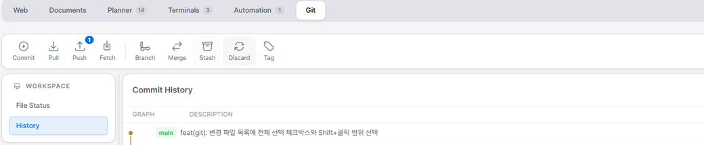
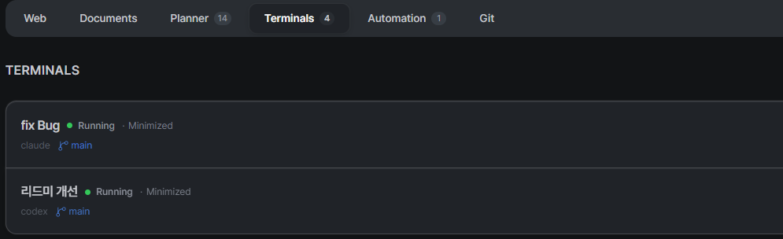

<div align="center">

<picture>
  <source media="(prefers-color-scheme: dark)" srcset="https://raw.githubusercontent.com/HyperAITeam/CLITrigger/main/src/client/public/logo.svg">
  <source media="(prefers-color-scheme: light)" srcset="https://raw.githubusercontent.com/HyperAITeam/CLITrigger/main/src/client/public/logo.svg">
  
</picture>

**Your coding agents work the night shift.**

*Queue the work before you leave. Review the diffs over coffee.*

<p align="center">
  <a href="https://github.com/HyperAITeam/CLITrigger/blob/main/README.md">English</a> ·
  <a href="https://github.com/HyperAITeam/CLITrigger/blob/main/README_KR.md">한국어</a>
</p>

[](LICENSE)
[](https://www.npmjs.com/package/clitrigger)
[](https://www.npmjs.com/package/clitrigger)
[](https://www.npmjs.com/package/clitrigger)
[](https://nodejs.org)
[](https://www.typescriptlang.org)
[](https://react.dev)
[](https://github.com/HyperAITeam/CLITrigger/stargazers)

<br>



<br><br>

```bash
npm i -g clitrigger && clitrigger
```

**Or grab the desktop app**, no Node.js required: **[Windows `.exe` · macOS `.dmg` · Linux `.AppImage`](https://github.com/HyperAITeam/CLITrigger/releases/latest)**

Open `http://localhost:3000`, set a password, add a project, write a few tasks, hit Start. That's the whole setup.

</div>

---

## What this is

You already run Claude Code, Codex, or Antigravity from a terminal. They're good. The catch is that they only work while you're sitting in front of them. You hit a rate limit at 11pm and the next five hours of quota go to waste. You close the laptop and nothing happens until you open it again.

CLITrigger puts those same CLIs on a queue. In Git projects, auto tasks run in separate worktrees by default and can run in parallel while you're away. When CLITrigger detects a rate-limit reset time, you can schedule a run for that time. If a CLI runs out of context, a configured fallback chain can restart the task with the next CLI. In the morning, open the review queue to inspect changes, merge completed branches, or discard runs.

During the day, run the same CLIs in dockable floating windows. Enable worktree isolation for sessions that need their own branch.

It runs on your own machine. Point a Cloudflare tunnel at it and you can check on it from your phone.

<div align="center">
  
  <p><em>Choose how the loop stops and which branch the task runs on.</em></p>
</div>

---

## How a night goes

**6:00pm.** You write five tasks in the project. Two of them depend on a third, so you chain them. One is "make the test suite pass", so you give it a loop rule: run `npm test` after every round, stop at exit code 0, cap it at 8 rounds and $5. You pull two files from the project docs into the prompt so the agent knows the conventions. You hit Start All.

**6:01pm.** Three tasks start in separate worktrees under `.worktrees/` inside the project. The two dependents wait for their prerequisite.

**9:40pm.** The first task finishes and commits. Its two dependents start, each with the parent branch squash-merged in. The project has an auto-delegate rule, so a second CLI gets a fresh task: review the first one's diff.

**11:15pm.** Claude hits its five-hour limit and reports a reset time. You open the task on your phone and use **Run on Reset** to schedule another run.

**4:10am.** The reset passes. The parked task runs.

**7:30am.** You open the review queue, expand a completed task’s diff, and press `m` to merge. For a failed task, you open its log with `Enter` and use Continue to send a follow-up.

That's a normal Tuesday.

---

## Features

### Before you leave

**Tasks and worktrees.** Auto tasks in Git projects use a dedicated worktree by default. Configure isolation per project or per task, and set the project’s concurrency limit. Dependent tasks start with the parent’s changes squash-merged in. Project settings control whether leftover worktree changes are auto-committed. [Wiki →](https://github.com/HyperAITeam/CLITrigger/wiki/Delegate-to-AI#parallel-worktree-execution)

**Loop rules.** In Automation → Auto Tasks, enable **Repeat until a done rule is satisfied (loop)** in the task form. Turn a task into a loop. Give it a verification command (exit 0 means done), or a done phrase to look for in the agent's last message. Add a max round count, a cost cap in USD, and a "stop if a round makes no commits" guard so a confused agent can't burn your budget. Rules you type in the box get appended to every round's prompt.

**Schedules.** Cron for recurring runs, one-off for a specific time, and a "run when the rate limit resets" button that reads the reset timestamp straight from the CLI output. Skip-if-running is on by default so a slow run doesn't stack up. [Wiki ↗](https://github.com/HyperAITeam/CLITrigger/wiki/Delegate-to-AI#scheduled-execution)

<div align="center">
  
</div>

**Fallback chain.** Order your CLIs, say Claude then Antigravity then Codex. When one runs out of context window, or Antigravity reports its quota is gone three times in a minute, the process is killed and the next CLI starts on the same task. [Wiki ↗](https://github.com/HyperAITeam/CLITrigger/wiki/Delegate-to-AI#multi-cli--sandbox-mode)

**Auto Reviewer.** When the chosen worker CLI completes a task, CLITrigger creates a dependent task for the reviewer CLI. The review starts with the worker’s changes merged in.

**Sandbox mode.** Strict mode uses directory-scoped tool permissions for Claude and a write sandbox for Codex. Antigravity auto tasks receive path guidance in the prompt. Configure terminal-session permissions separately in project settings. [Wiki →](https://github.com/HyperAITeam/CLITrigger/wiki/Delegate-to-AI#sandbox-mode)

**Docs.** A per-project folder of markdown with `[[wikilinks]]` and a graph view, grouped by folder or by tag, with tags you can put on any file or folder without touching it. Pick files and they go into the prompt, whichever CLI you're using. Lessons from past runs are saved as plain markdown in the same folder, so there's no separate wiki to keep in sync. [Wiki ↗](https://github.com/HyperAITeam/CLITrigger/wiki/Plan-&-Organize#vault)

<div align="center">
  
</div>

**Planner and calendar.** A plain list for ideas that aren't tasks yet. Turn any line into a task, a schedule, or a session with one click. My Schedule overlays your memos, every project's schedules, planner due dates, and assigned Jira issues on one calendar. [Wiki ↗](https://github.com/HyperAITeam/CLITrigger/wiki/Plan-&-Organize#planner)

<div align="center">
  
</div>

**Multi-agent discussion.** For the tasks you don't want to just fire off: an architect, a developer, and a reviewer argue about the approach first. The outcome can be committed as code or sent to the planner as action items. [Wiki ↗](https://github.com/HyperAITeam/CLITrigger/wiki/Delegate-to-AI#multi-agent-discussion)

<div align="center">
  
</div>

### While you're out

**Live logs.** Every run streams over WebSocket. Chat mode renders the markdown, Raw mode is the actual terminal bytes. Raw output is stored, so reconnecting replays exactly what happened. [Wiki ↗](https://github.com/HyperAITeam/CLITrigger/wiki/Review-&-Ship#live-logs)

**Remote access.** `clitrigger config tunnel on` and you get a Cloudflare URL. Name the tunnel and route it through your own domain to avoid the "dangerous site" warning. [Wiki ↗](https://github.com/HyperAITeam/CLITrigger/wiki/Remote-Access)

**Notifications.** A bell in the sidebar turns on OS notifications for finished and failed runs. Click one and it jumps to that session.

**MCP server.** CLITrigger exposes itself over HTTP as an MCP server. Register it with Claude Code, Codex, or Antigravity in one click from Settings → MCP (or paste the config into Claude Desktop), and you can list projects, create and start tasks, hand the rest of a conversation off to new sessions or auto tasks, and check status from a chat. [Wiki ↗](https://github.com/HyperAITeam/CLITrigger/wiki/MCP-Server)

**Analytics.** Cost and tokens per project, split by CLI, status, and date. Useful for noticing that one loop task ate half the month. [Wiki ↗](https://github.com/HyperAITeam/CLITrigger/wiki/Review-&-Ship#analytics)

<div align="center">
  
</div>

### The next morning

**Review queue.** See recent auto tasks across projects. Choose 12h, 24h, or 7d and filter by All, Done, Failed, or Stopped. Cards show summaries, token totals, and diff stats. Use `j`/`k` to move, `Space` to expand changes, `Enter` for logs, `m` to merge, or `d` to discard. [Wiki →](https://github.com/HyperAITeam/CLITrigger/wiki/Review-&-Ship#morning-review-queue)

**Git client.** Stage, commit, push, branches, commit graph, file diffs, and a conflict resolver. All inside CLITrigger, so you can land an agent's branch from the same screen you reviewed it on. [Wiki ↗](https://github.com/HyperAITeam/CLITrigger/wiki/Review-&-Ship#built-in-git-client)

<div align="center">
  
  <p><em>Use File Status to select changed files and History to inspect branches and commits.</em></p>
</div>

**SVN too.** If the project is a Subversion working copy, turn on the SVN panel: status, log, diff, commit, externals, and properties. Same diff viewer as git.

### Daytime, when you are at the desk

**Sessions.** Long-lived interactive CLI sessions in floating windows. Dock them side by side VS Code style, pop one out to a separate window, tag and alias them. Real xterm.js terminals on node-pty. Each session can live on its own worktree branch. [Wiki ↗](https://github.com/HyperAITeam/CLITrigger/wiki/Delegate-to-AI#interactive-sessions)

<div align="center">
  
</div>

**Integrations.** Jira, GitHub Issues, and Notion as plugins. gstack skills as an execution hook. A Harness panel for editing each CLI's settings, memory, MCP config, and toggling skills, hooks, and plugins without opening the dotfiles.

**Small things.** A Files tab to browse the repo. A Favorites launcher for the tools you open ten times a day. Web panel tabs in the desktop app for keeping Notion or a dashboard next to your sessions. A process panel showing which CLI processes are actually alive.

---

## Tech stack

| Layer | Tech |
|-------|------|
| Backend | Node.js · Express · TypeScript · SQLite (better-sqlite3, WAL) · WebSocket |
| Frontend | React 18 · Vite · Tailwind CSS · Recharts |
| CLIs | Claude Code · Antigravity · Codex, behind one adapter interface |
| Git | simple-git for worktrees and merges |
| Scheduling | node-cron |
| Terminal | node-pty · xterm.js |
| Remote access | Cloudflare Tunnel (optional) |
| Desktop | Electron, bundles Node and the native modules |

---

## Install

### Desktop app

Download the installer from the [latest release](https://github.com/HyperAITeam/CLITrigger/releases/latest):

- **Windows**: `CLITrigger-Setup-<version>.exe`, or the portable `.exe`
- **macOS**: `CLITrigger-<version>.dmg` (Apple Silicon and Intel)
- **Linux**: `CLITrigger-<version>.AppImage`

Node.js, `better-sqlite3`, `node-pty`, and `cloudflared` are bundled. First launch shows a setup screen where you pick a password. The tunnel stays off until setup is done, so nobody else can be the first user.

### npm

```bash
npm i -g clitrigger
clitrigger
```

The server starts on port 3000. Open it, set a password, add a project, write tasks. You can change the password later in Settings → Account.

When a newer version is on npm, startup prints a one-line hint. It won't update itself.

```bash
npm i -g clitrigger@latest     # upgrade
clitrigger --version
clitrigger config port 8080    # change port
clitrigger config tunnel on    # Cloudflare tunnel
clitrigger reset-password      # forgot it
```

> **You need:** Node.js 22+ (an LTS release), Git, and at least one of Claude Code, Antigravity, or Codex installed and logged in.
>
> **Platforms:** Windows, macOS, Linux.
> Stick to even-numbered Node releases. A brand-new major often has no prebuilt binaries for the native modules yet, which means a C++ toolchain and a long compile.

### From source

<details>
<summary>Expand</summary>

```bash
git clone https://github.com/HyperAITeam/CLITrigger.git
cd CLITrigger
npm install
cd src/client && npm install && cd ../..

cp .env.example .env
# AUTH_PASSWORD can stay blank; the setup screen will ask on first load.

npm run dev
```

Open `http://localhost:5173`.

On Windows there are `.bat` files in `scripts/` for install, dev, build, start, start-tunnel, and test. On macOS and Linux use the matching `npm run` commands.

```bash
npm run dev
npm run build
npm run start
npm test
```

</details>

### Remote access

```bash
winget install cloudflare.cloudflared    # Windows
brew install cloudflared                  # macOS

clitrigger config tunnel on
clitrigger
# prints https://xxxx.trycloudflare.com
```

Browsers warn about `*.trycloudflare.com`. To get rid of that, name the tunnel and route it through a domain you own. Either in the sidebar ⚙ → Tunnel modal, or:

```bash
clitrigger config tunnel on my-tunnel
clitrigger config tunnel hostname app.your-domain.com
cloudflared tunnel route dns my-tunnel app.your-domain.com   # once
```

---

## Docs

The full manual is in the [Wiki](https://github.com/HyperAITeam/CLITrigger/wiki).

| Doc | What's in it |
|-----|--------------|
| [Wiki](https://github.com/HyperAITeam/CLITrigger/wiki) | Every feature, with screenshots |
| [SETUP.md](docs/SETUP.md) | Install and usage guide, section by section (Korean) |
| [changelog/](docs/changelog/README.md) | What changed, by date |
| [CICD.md](docs/CICD.md) | GitHub Actions setup |
| [TESTING.md](docs/TESTING.md) | How the tests are laid out |

---

## Contributing

If this saves you an evening, a [star](https://github.com/HyperAITeam/CLITrigger) helps other people find it.

- Bugs, feature requests, half-baked ideas: [Issues](https://github.com/HyperAITeam/CLITrigger/issues)
- PRs: start with [`good first issue`](https://github.com/HyperAITeam/CLITrigger/issues?q=is%3Aissue+is%3Aopen+label%3A%22good+first+issue%22), or fix whatever bothered you
- Workflows, plugins, loop rules that worked well: [Discussions](https://github.com/HyperAITeam/CLITrigger/discussions)

<a href="https://github.com/HyperAITeam/CLITrigger/graphs/contributors">
  
</a>

---

## Star history

<a href="https://www.star-history.com/?type=date&repos=HyperAITeam%2FCLITrigger">
  <picture>
    <source media="(prefers-color-scheme: dark)" srcset="https://api.star-history.com/chart?repos=HyperAITeam/CLITrigger&type=date&theme=dark&legend=top-left&sealed_token=R33OVQ1e-AI8ctoPaGe7ewkSmvN8Gu6hjU17eN9yHxckmgmY1pKvDR0YS3EfDfyFavnkF5BMNNUrMGZamuP7ietWibyDuGoDy_ybdNuzDCMmursd6di3qZwAfwxle8hIWF3a-uP51KiD_cqthhcgCkZk3kgiYz8DA6K-du4SYqSAD9Nhas8olSX2Ax1R" />
    <source media="(prefers-color-scheme: light)" srcset="https://api.star-history.com/chart?repos=HyperAITeam/CLITrigger&type=date&legend=top-left&sealed_token=R33OVQ1e-AI8ctoPaGe7ewkSmvN8Gu6hjU17eN9yHxckmgmY1pKvDR0YS3EfDfyFavnkF5BMNNUrMGZamuP7ietWibyDuGoDy_ybdNuzDCMmursd6di3qZwAfwxle8hIWF3a-uP51KiD_cqthhcgCkZk3kgiYz8DA6K-du4SYqSAD9Nhas8olSX2Ax1R" />
    
  </picture>
</a>

---

## Coffee

<div align="center">

[](https://buymeacoffee.com/osgoodyz)

</div>

---

## License

[MIT](LICENSE)
