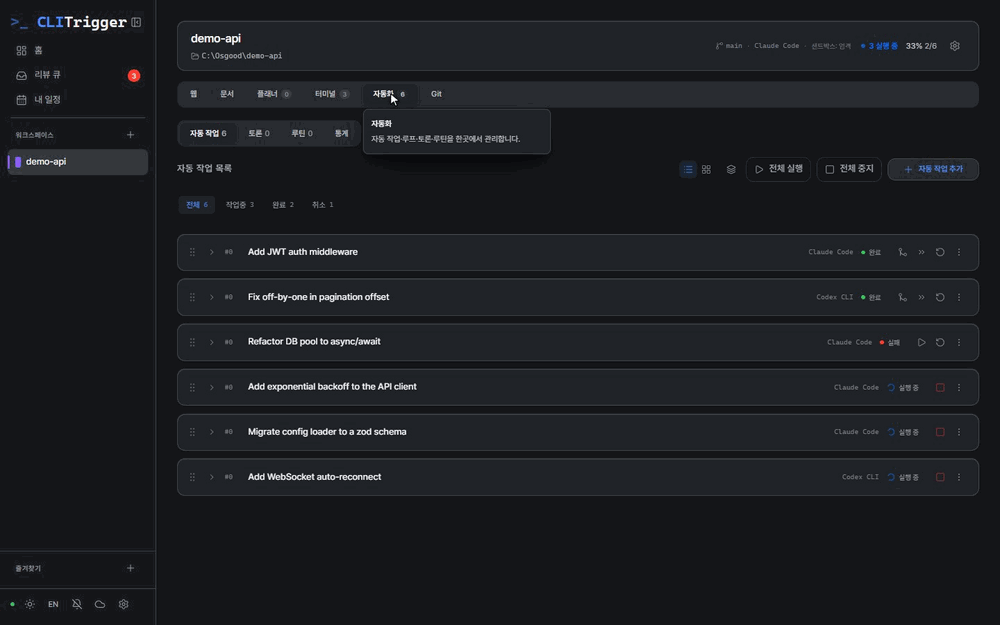
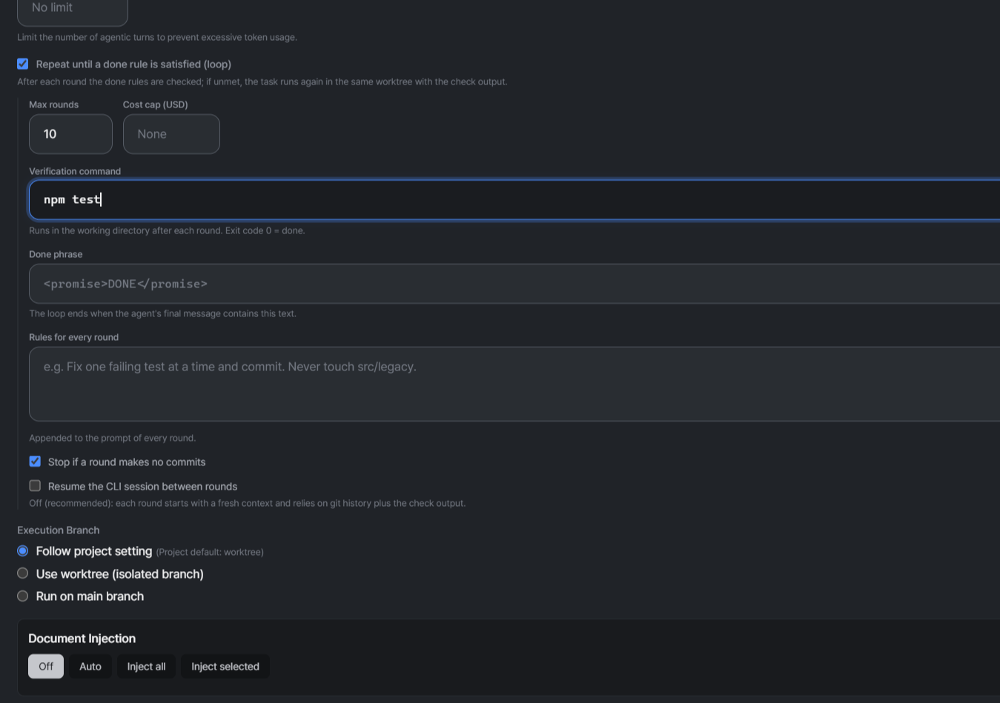
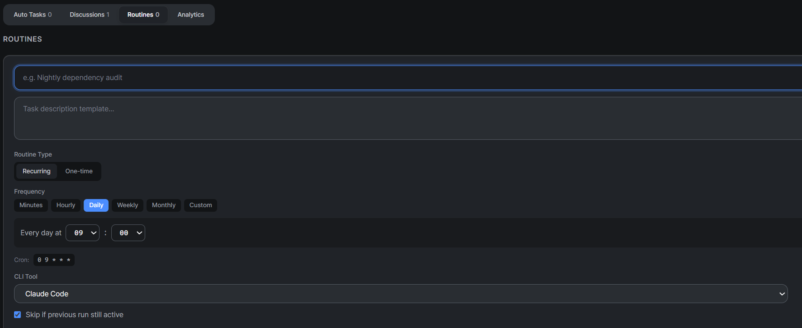
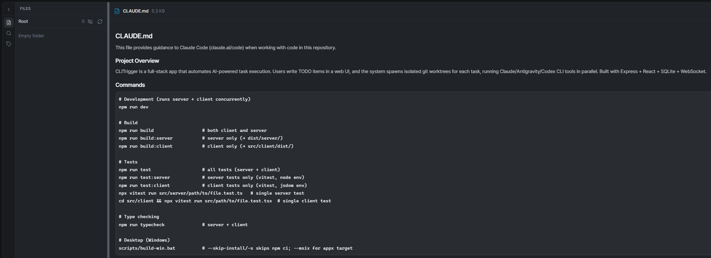
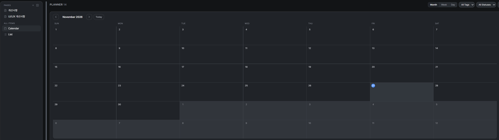
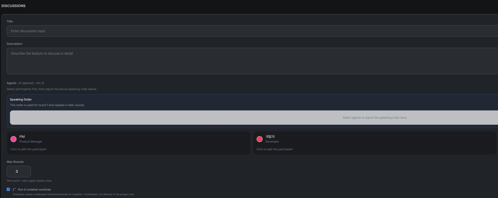
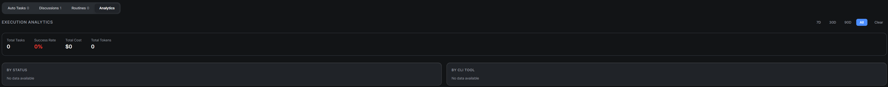
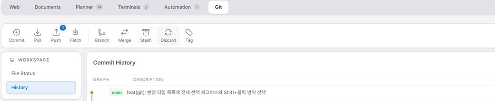
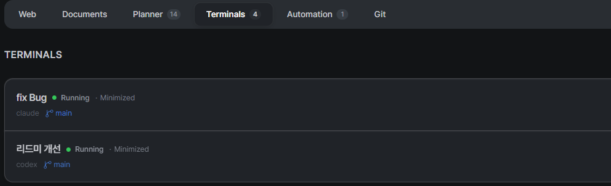

<div align="center">

<picture>
  <source media="(prefers-color-scheme: dark)" srcset="https://raw.githubusercontent.com/HyperAITeam/CLITrigger/main/src/client/public/logo.svg">
  <source media="(prefers-color-scheme: light)" srcset="https://raw.githubusercontent.com/HyperAITeam/CLITrigger/main/src/client/public/logo.svg">
  
</picture>

**퇴근하면 AI 코딩 에이전트가 야근을 시작한다.**

*퇴근 전에 할 일을 쌓아두고, 아침엔 diff만 본다.*

<p align="center">
  <a href="https://github.com/HyperAITeam/CLITrigger/blob/main/README.md">English</a> ·
  <a href="https://github.com/HyperAITeam/CLITrigger/blob/main/README_KR.md">한국어</a>
</p>

[](LICENSE)
[](https://www.npmjs.com/package/clitrigger)
[](https://www.npmjs.com/package/clitrigger)
[](https://www.npmjs.com/package/clitrigger)
[](https://nodejs.org)
[](https://www.typescriptlang.org)
[](https://react.dev)
[](https://github.com/HyperAITeam/CLITrigger/stargazers)

<br>



<br><br>

```bash
npm i -g clitrigger && clitrigger
```

**데스크톱 앱으로 받아도 된다.** Node.js 없이 바로 실행: **[Windows `.exe` · macOS `.dmg` · Linux `.AppImage`](https://github.com/HyperAITeam/CLITrigger/releases/latest)**

`http://localhost:3000` 열고, 비밀번호 정하고, 프로젝트 추가하고, 할 일 몇 개 적고, Start. 설정은 그게 전부다.

</div>

---

## 이게 뭔가

Claude Code, Codex, Antigravity를 터미널에서 이미 쓰고 있을 것이다. 잘 돌아간다. 문제는 내가 앞에 앉아 있을 때만 돌아간다는 것. 밤 11시에 rate limit에 걸리면 다음 다섯 시간치 쿼터는 그냥 날아간다. 노트북을 덮으면 다시 열 때까지 아무 일도 안 일어난다.

CLITrigger는 그 CLI들을 큐에 올려 실행한다. Git 프로젝트의 자동 작업은 기본적으로 별도 워크트리에서 병렬로 실행할 수 있다. 사용량 한도 초기화 시각을 감지하면 그 시각에 실행을 예약할 수 있다. 컨텍스트가 바닥나면 설정한 폴백 체인의 다음 CLI로 작업을 다시 실행할 수 있다. 아침에는 리뷰 큐에서 변경을 검토하고 완료된 브랜치를 머지하거나 실행 결과를 폐기한다.

낮에는 같은 CLI들을 도킹할 수 있는 플로팅 창에 띄운다. 별도 브랜치가 필요한 세션은 워크트리 격리를 켠다.

전부 내 컴퓨터에서 돈다. Cloudflare 터널만 붙이면 폰에서도 들여다볼 수 있다.

<div align="center">
  
  <p><em>CLI 셋, worktree 셋, 화면 하나</em></p>
</div>

---

## 하룻밤이 흘러가는 방식

**18:00.** 프로젝트에 할 일 다섯 개를 적는다. 둘은 세 번째 작업이 끝나야 시작할 수 있으니 의존성으로 묶는다. 하나는 "테스트 전부 통과시키기"라서 루프 규칙을 건다. 라운드마다 `npm test`를 돌리고, exit 0이면 종료, 최대 8라운드, 비용 상한 5달러. 프로젝트 문서 두 개를 프롬프트에 끼워 넣어 컨벤션을 알려준다. Start All.

**18:01.** 세 작업이 프로젝트의 `.worktrees/` 아래 별도 워크트리에서 시작한다. 나머지 두 작업은 선행 작업이 끝날 때까지 기다린다.

**21:40.** 첫 작업이 끝나고 커밋된다. 기다리던 둘이 부모 브랜치를 squash merge한 상태로 시작한다. 프로젝트에 자동 위임 규칙이 있어서, 다른 CLI에게 "첫 작업의 diff를 리뷰해라"라는 작업이 새로 생긴다.

**23:15.** Claude가 5시간 한도에 걸려 리셋 시각을 출력한다. 휴대전화에서 작업을 열고 **리셋 시점에 실행 예약**으로 다음 실행을 예약한다.

**04:10.** 리셋이 지나고 예약된 작업이 돈다.

**07:30.** 리뷰 큐를 열고 완료된 작업의 diff를 펼쳐 확인한 뒤 `m`으로 머지한다. 실패한 작업은 `Enter`로 로그를 열고 Continue로 지시를 보탠다.

평범한 화요일이다.

---

## 기능

### 퇴근 전에

**작업과 worktree.** Git 프로젝트의 자동 작업은 기본적으로 개별 worktree에서 실행된다. 프로젝트 기본값과 작업별 설정으로 격리를 조정하고, 최대 동시 실행 수를 정할 수 있다. 의존 작업은 상위 작업의 변경을 squash merge해 시작한다. worktree에 남은 변경의 자동 커밋은 프로젝트 설정에서 제어한다. [Wiki →](https://github.com/HyperAITeam/CLITrigger/wiki/Delegate-to-AI-KR#병렬-워크트리-실행)

**루프 규칙.** 자동화 → 자동 작업의 작업 폼에서 **종료 규칙이 만족될 때까지 반복 (루프)**을 켠다. 작업 하나를 루프로 만든다. 검증 명령을 주면 exit 0일 때 종료하고, 완료 문구를 주면 에이전트 마지막 메시지에 그 문구가 있을 때 종료한다. 최대 라운드, 비용 상한(USD), "커밋 없이 끝난 라운드가 있으면 중단" 옵션으로 헤매는 에이전트가 예산을 태우지 못하게 막는다. 규칙 칸에 적은 내용은 매 라운드 프롬프트 끝에 붙는다.

**예약 실행.** cron으로 반복, 일회성으로 특정 시각, 그리고 CLI 출력에서 읽은 리셋 시각에 바로 거는 "리셋 시점에 실행 예약" 버튼. 이전 실행이 아직 돌고 있으면 건너뛰는 옵션이 있어서 느린 작업이 쌓이지 않는다. [Wiki ↗](https://github.com/HyperAITeam/CLITrigger/wiki/Delegate-to-AI-KR#스케줄-실행)

<div align="center">
  
</div>

**폴백 체인.** CLI 순서를 정해둔다. 예를 들면 Claude, Antigravity, Codex 순. 하나가 컨텍스트 윈도우를 다 쓰거나 Antigravity가 1분 안에 세 번 쿼터 소진을 뱉으면, 프로세스를 죽이고 다음 CLI가 같은 작업을 이어받는다. [Wiki ↗](https://github.com/HyperAITeam/CLITrigger/wiki/Delegate-to-AI-KR#멀티-cli--샌드박스-모드)

**자동 리뷰어.** 지정한 CLI의 작업이 완료되면 리뷰 CLI용 후속 작업을 만든다. 리뷰 작업은 원본 작업에 의존하고, 원본 변경을 머지한 상태에서 시작한다.

**샌드박스 모드.** 엄격 모드의 권한은 CLI마다 다르다. Claude는 경로별 도구 권한을, Codex는 쓰기용 샌드박스를, Antigravity 자동 작업은 프롬프트의 경로 지침을 사용한다. 터미널 세션 권한은 프로젝트 설정에서 별도로 조정한다. [Wiki →](https://github.com/HyperAITeam/CLITrigger/wiki/Delegate-to-AI-KR#샌드박스-모드)

**문서.** 프로젝트별 마크다운 폴더에 `[[wikilink]]`와 그래프 뷰. 그래프는 폴더나 태그로 묶어 보고, 태그는 파일을 건드리지 않고 아무 파일·폴더에나 붙인다. 파일을 골라 프롬프트에 넣으면 어떤 CLI를 쓰든 똑같이 들어간다. 지난 실행에서 얻은 교훈도 같은 폴더에 평범한 마크다운으로 쌓이니, 따로 맞춰 둘 위키가 없다. [Wiki ↗](https://github.com/HyperAITeam/CLITrigger/wiki/Plan-&-Organize-KR#볼트)

<div align="center">
  
</div>

**플래너와 캘린더.** 아직 작업이 아닌 생각들을 적어두는 목록. 어떤 줄이든 클릭 한 번으로 작업, 예약, 세션이 된다. 내 일정은 메모, 전 프로젝트 예약, 플래너 마감일, 내게 할당된 Jira 이슈를 캘린더 하나에 겹쳐 보여준다. [Wiki ↗](https://github.com/HyperAITeam/CLITrigger/wiki/Plan-&-Organize-KR#플래너)

<div align="center">
  
</div>

**다중 에이전트 토론.** 그냥 던지기엔 찜찜한 작업용. 아키텍트, 개발자, 리뷰어가 먼저 접근 방식을 두고 싸운다. 결론은 코드로 커밋하거나 플래너에 액션 아이템으로 보낸다. [Wiki ↗](https://github.com/HyperAITeam/CLITrigger/wiki/Delegate-to-AI-KR#멀티-에이전트-토론)

<div align="center">
  
</div>

### 자리를 비운 동안

**실시간 로그.** 모든 실행이 WebSocket으로 흘러온다. Chat 모드는 마크다운으로 렌더링하고, Raw 모드는 터미널 바이트 그대로다. Raw 출력은 저장되기 때문에 다시 접속해도 그대로 재생된다. [Wiki ↗](https://github.com/HyperAITeam/CLITrigger/wiki/Review-&-Ship-KR#실시간-로그)

**외부 접속.** `clitrigger config tunnel on` 하면 Cloudflare URL이 나온다. 터널에 이름을 붙이고 내 도메인으로 라우팅하면 "위험한 사이트" 경고가 사라진다. [Wiki ↗](https://github.com/HyperAITeam/CLITrigger/wiki/Remote-Access-KR)

**알림.** 사이드바의 종 아이콘을 켜면 완료와 실패를 OS 알림으로 받는다. 알림을 클릭하면 그 세션으로 바로 간다.

**MCP 서버.** CLITrigger 자체가 HTTP MCP 서버다. 설정 → MCP에서 Claude Code, Codex, Antigravity에 클릭 한 번으로 등록하면(Claude Desktop은 config를 붙여 넣으면), 채팅으로 프로젝트 조회, 작업 생성과 실행, 남은 대화를 새 세션이나 자동 작업으로 넘기기, 상태 확인이 된다. [Wiki ↗](https://github.com/HyperAITeam/CLITrigger/wiki/MCP-Server-KR)

**통계.** 프로젝트별 비용과 토큰을 CLI, 상태, 날짜로 나눠 본다. 루프 작업 하나가 한 달 예산 절반을 먹었다는 걸 알아채는 용도. [Wiki ↗](https://github.com/HyperAITeam/CLITrigger/wiki/Review-&-Ship-KR#분석)

<div align="center">
  
</div>

### 다음 날 아침

**리뷰 큐.** 모든 프로젝트의 최근 자동 작업을 모아 보여준다. 기간은 12시간, 24시간 또는 7일이며 상태는 전체, 완료, 실패, 중지로 거를 수 있다. 카드에서 요약, 토큰, 변경 줄 수를 확인한다. `j`/`k`로 이동, `Space`로 변경 파일과 diff 펼치기, `Enter`로 로그 열기, `m`으로 머지, `d`로 폐기한다. [Wiki →](https://github.com/HyperAITeam/CLITrigger/wiki/Review-&-Ship-KR#모닝-리뷰-큐)

**Git 클라이언트.** 스테이지, 커밋, 푸시, 브랜치, 커밋 그래프, 파일 diff, 충돌 해결까지 CLITrigger 안에서. 리뷰한 화면에서 그대로 에이전트 브랜치를 올릴 수 있다. [Wiki ↗](https://github.com/HyperAITeam/CLITrigger/wiki/Review-&-Ship-KR#내장-git-클라이언트)

<div align="center">
  
  <p><em>File Status에서 변경 파일을 선택하고, History에서 브랜치와 커밋 그래프를 확인한다.</em></p>
</div>

**SVN도 된다.** 프로젝트가 Subversion 작업 사본이면 SVN 패널을 켠다. 상태, 로그, diff, 커밋, externals, 속성 편집. diff 뷰어는 git과 같은 걸 쓴다.

### 낮에, 자리에 있을 때

**세션.** 플로팅 창에서 돌아가는 장시간 인터랙티브 CLI 세션. VS Code처럼 나란히 도킹하고, 별도 창으로 빼고, 태그와 별칭을 붙인다. node-pty 위의 진짜 xterm.js 터미널이다. 세션마다 자기 worktree 브랜치를 가질 수 있다. [Wiki ↗](https://github.com/HyperAITeam/CLITrigger/wiki/Delegate-to-AI-KR#인터랙티브-세션)

<div align="center">
  
</div>

**연동.** Jira, GitHub Issues, Notion이 플러그인으로 붙는다. gstack 스킬은 실행 훅으로. Harness 패널에서는 각 CLI의 설정, 메모리, MCP config를 고치고 스킬, 훅, 플러그인을 켜고 끌 수 있다. dotfile을 열 필요가 없다.

**자잘한 것들.** 저장소를 둘러보는 Files 탭. 하루에 열 번 여는 도구를 모아둔 즐겨찾기 런처. 데스크톱 앱에서 Notion이나 대시보드를 세션 옆에 띄워두는 웹 패널 탭. 어떤 CLI 프로세스가 실제로 살아 있는지 보여주는 프로세스 패널.

---

## 기술 스택

| 영역 | 기술 |
|------|------|
| 백엔드 | Node.js · Express · TypeScript · SQLite (better-sqlite3, WAL) · WebSocket |
| 프론트엔드 | React 18 · Vite · Tailwind CSS · Recharts |
| CLI | Claude Code · Antigravity · Codex, 어댑터 인터페이스 하나 뒤에 |
| Git | simple-git으로 worktree와 머지 |
| 스케줄링 | node-cron |
| 터미널 | node-pty · xterm.js |
| 외부 접속 | Cloudflare Tunnel (선택) |
| 데스크톱 | Electron, Node와 네이티브 모듈 번들 |

---

## 설치

### 데스크톱 앱

[최신 릴리스](https://github.com/HyperAITeam/CLITrigger/releases/latest)에서 설치 파일을 받는다.

- **Windows**: `CLITrigger-Setup-<version>.exe` 또는 portable `.exe`
- **macOS**: `CLITrigger-<version>.dmg` (Apple Silicon · Intel)
- **Linux**: `CLITrigger-<version>.AppImage`

Node.js, `better-sqlite3`, `node-pty`, `cloudflared`가 전부 들어 있다. 첫 실행 때 셋업 화면에서 비밀번호를 정한다. 셋업이 끝날 때까지 터널은 꺼져 있어서 첫 사용자는 반드시 본인이다.

### npm

```bash
npm i -g clitrigger
clitrigger
```

3000번 포트에서 서버가 뜬다. 열고, 비밀번호 정하고, 프로젝트 추가하고, 할 일을 적는다. 비밀번호는 나중에 설정 → 계정에서 바꿀 수 있다.

npm에 새 버전이 있으면 시작할 때 한 줄 알려준다. 알아서 업데이트하지는 않는다.

```bash
npm i -g clitrigger@latest     # 업그레이드
clitrigger --version
clitrigger config port 8080    # 포트 변경
clitrigger config tunnel on    # Cloudflare 터널
clitrigger reset-password      # 비밀번호를 잊었을 때
```

> **필요한 것:** Node.js 22+ (LTS), Git, 그리고 Claude Code · Antigravity · Codex 중 하나 이상이 설치되고 로그인된 상태.
>
> **플랫폼:** Windows · macOS · Linux.
> Node는 짝수 버전을 쓰는 게 좋다. 갓 나온 메이저는 네이티브 모듈의 prebuilt 바이너리가 아직 없는 경우가 많아서 C++ 툴체인과 긴 컴파일이 필요해진다.

### 소스에서

<details>
<summary>펼치기</summary>

```bash
git clone https://github.com/HyperAITeam/CLITrigger.git
cd CLITrigger
npm install
cd src/client && npm install && cd ../..

cp .env.example .env
# AUTH_PASSWORD는 비워둬도 된다. 첫 접속 때 셋업 화면이 물어본다.

npm run dev
```

`http://localhost:5173` 접속.

Windows라면 `scripts/`에 install, dev, build, start, start-tunnel, test용 `.bat`이 있다. macOS와 Linux는 같은 이름의 `npm run` 명령을 쓰면 된다.

```bash
npm run dev
npm run build
npm run start
npm test
```

</details>

### 외부 접속

```bash
winget install cloudflare.cloudflared    # Windows
brew install cloudflared                  # macOS

clitrigger config tunnel on
clitrigger
# https://xxxx.trycloudflare.com 출력
```

브라우저가 `*.trycloudflare.com`에 경고를 띄운다. 없애려면 터널에 이름을 붙이고 내 도메인으로 라우팅한다. 사이드바 ⚙ → Tunnel 모달에서 하거나, CLI로:

```bash
clitrigger config tunnel on my-tunnel
clitrigger config tunnel hostname app.your-domain.com
cloudflared tunnel route dns my-tunnel app.your-domain.com   # 한 번만
```

---

## 문서

전체 매뉴얼은 [Wiki (한국어)](https://github.com/HyperAITeam/CLITrigger/wiki/Home-KR)에 있다.

| 문서 | 내용 |
|------|------|
| [Wiki (한국어)](https://github.com/HyperAITeam/CLITrigger/wiki/Home-KR) | 기능별 가이드, 스크린샷 포함 |
| [SETUP.md](docs/SETUP.md) | 설치와 사용법, 항목별 정리 |
| [changelog/](docs/changelog/README.md) | 날짜별 변경 이력 |
| [CICD.md](docs/CICD.md) | GitHub Actions 설정 |
| [TESTING.md](docs/TESTING.md) | 테스트 구조 |

---

## 함께 만들기

저녁 시간 하나를 아꼈다면 [Star](https://github.com/HyperAITeam/CLITrigger) 하나가 다른 사람이 이걸 찾는 데 도움이 된다.

- 버그, 기능 제안, 덜 익은 아이디어: [Issues](https://github.com/HyperAITeam/CLITrigger/issues)
- PR: [`good first issue`](https://github.com/HyperAITeam/CLITrigger/issues?q=is%3Aissue+is%3Aopen+label%3A%22good+first+issue%22)부터, 아니면 거슬렸던 거 아무거나
- 잘 먹힌 워크플로우, 플러그인, 루프 규칙: [Discussions](https://github.com/HyperAITeam/CLITrigger/discussions)

<a href="https://github.com/HyperAITeam/CLITrigger/graphs/contributors">
  
</a>

---

## Star History

<a href="https://www.star-history.com/?type=date&repos=HyperAITeam%2FCLITrigger">
  <picture>
    <source media="(prefers-color-scheme: dark)" srcset="https://api.star-history.com/chart?repos=HyperAITeam/CLITrigger&type=date&theme=dark&legend=top-left&sealed_token=R33OVQ1e-AI8ctoPaGe7ewkSmvN8Gu6hjU17eN9yHxckmgmY1pKvDR0YS3EfDfyFavnkF5BMNNUrMGZamuP7ietWibyDuGoDy_ybdNuzDCMmursd6di3qZwAfwxle8hIWF3a-uP51KiD_cqthhcgCkZk3kgiYz8DA6K-du4SYqSAD9Nhas8olSX2Ax1R" />
    <source media="(prefers-color-scheme: light)" srcset="https://api.star-history.com/chart?repos=HyperAITeam/CLITrigger&type=date&legend=top-left&sealed_token=R33OVQ1e-AI8ctoPaGe7ewkSmvN8Gu6hjU17eN9yHxckmgmY1pKvDR0YS3EfDfyFavnkF5BMNNUrMGZamuP7ietWibyDuGoDy_ybdNuzDCMmursd6di3qZwAfwxle8hIWF3a-uP51KiD_cqthhcgCkZk3kgiYz8DA6K-du4SYqSAD9Nhas8olSX2Ax1R" />
    
  </picture>
</a>

---

## 커피

<div align="center">

[](https://buymeacoffee.com/osgoodyz)

</div>

---

## 라이선스

[MIT](LICENSE)
